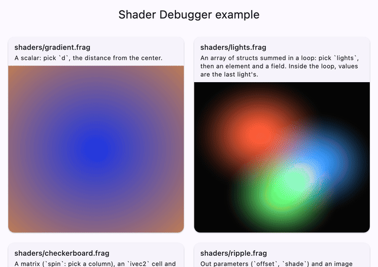
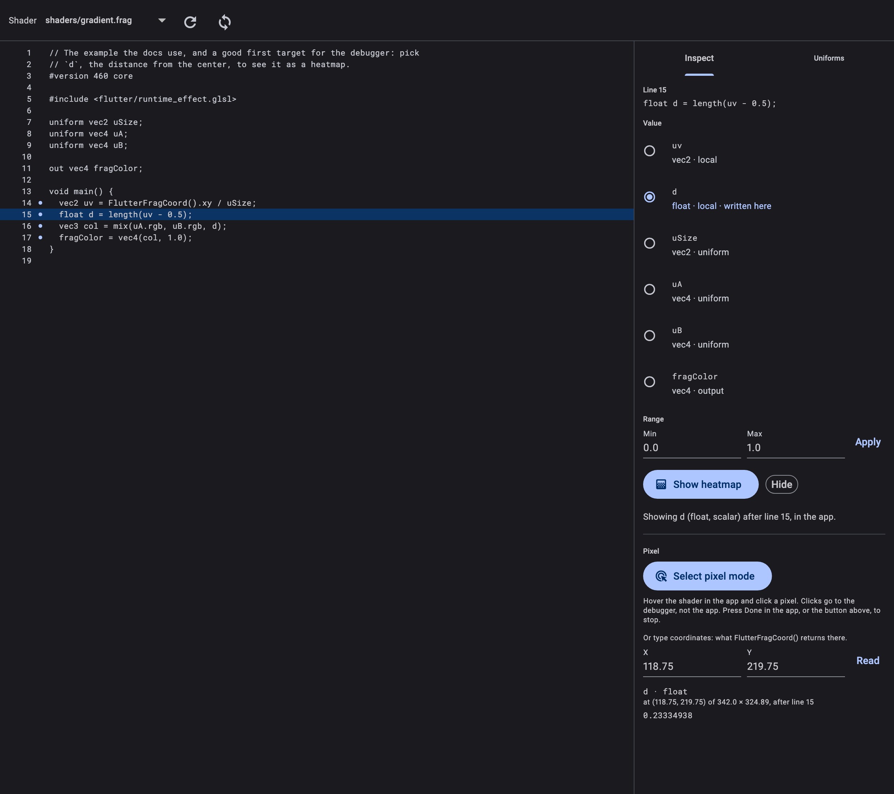
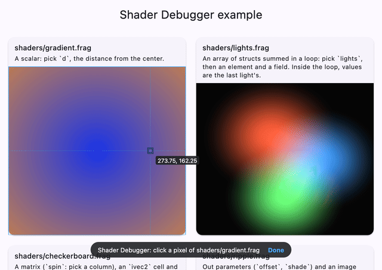
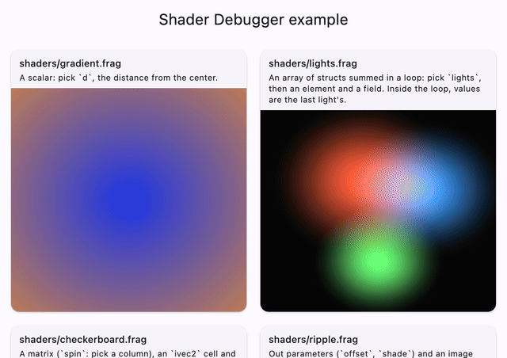

<h1 align="center">Flutter Shader Debugger</h1>

<p align="center">
  <strong>Debug Flutter fragment shaders where they run.</strong><br>
  Pick any variable in a <code>.frag</code> file and see it as a live heatmap in
  your app, read its exact value at a pixel, and tweak uniforms while the app
  runs, from a DevTools tab.
</p>

<p align="center">
  <a href="https://pub.dev/packages/shader_debugger"></a>
  <a href="https://github.com/mohamedalsamrai/shader_debugger/actions/workflows/ci.yml"></a>
  <a href="LICENSE"></a>
  
</p>

<p align="center">
  
</p>

Outside Flutter, shader authors have Xcode's Metal debugger, RenderDoc or
Shader Studio. This project brings that kind of debugging to Flutter's
`FragmentProgram` shaders, as a DevTools extension and a debug-only runtime
package.

## Features

| | |
|---|---|
| **Heatmaps of any value**<br>Click a line, pick a variable, and the app draws it instead of the color: scalars through a colormap, vectors as RG or RGB, and any column, element or field of a matrix, array or struct. |  |
| **Exact values at a pixel**<br>*Select pixel mode*, like the widget inspector's: hover the shader in the app, click a pixel, read the value as 32-bit floats. |  |
| **Live uniform overrides**<br>Every float uniform gets sliders; the app, the heatmap and pixel reads all use your values. |  |

Your shaders stay untouched: the debugger instruments a copy, hot reloads it
in, and keeps your uniforms flowing into it. In profile and release builds the
runtime does nothing.

## Get started

Add [`shader_debugger`](https://pub.dev/packages/shader_debugger), register a
placeholder probe shader, and draw your shaders through `DebugShader`. The
[package README](packages/shader_debugger/README.md) walks through the four
steps; the [example app](packages/shader_debugger/example) is a gallery of
shaders to try it on.

## Repository

This is a pub workspace: one `flutter pub get` at the root sets up every
package.

| Package | What it is |
|---|---|
| [`shader_debugger`](packages/shader_debugger) | The runtime your app depends on. Debug only; it also ships the DevTools extension. [](https://pub.dev/packages/shader_debugger) |
| [`shader_debugger_core`](packages/shader_debugger_core) | Pure Dart: the GLSL analyzer and the probe instrumenter. [](https://pub.dev/packages/shader_debugger_core) |
| [`shader_debugger_devtools`](packages/shader_debugger_devtools) | The DevTools extension (Flutter web). Not published on its own. |
| [`example`](packages/shader_debugger/example) | The gallery of shaders. |

[docs/architecture.md](docs/architecture.md) covers how it works: the
analyzer, probes, shader hot reload, pixel reads and the protocol between the
app and DevTools.

## Develop

Requires Flutter 3.47 or later.

```sh
flutter pub get
flutter analyze
(cd packages/shader_debugger_core && dart test)              # with impellerc shader compiles
(cd packages/shader_debugger/example && flutter test)        # the runtime, real shaders
(cd packages/shader_debugger_devtools && flutter test)       # the extension
python3 tool/e2e_heatmap.py                                  # end to end in the real app (macOS)
```

To use your build of the extension, build it into the runtime package, then run
the example and open DevTools:

```sh
(cd packages/shader_debugger_devtools && \
  dart run devtools_extensions build_and_copy --source=. --dest=../shader_debugger/extension/devtools)
(cd packages/shader_debugger/example && flutter run -d macos)
```

CI ([`.github/workflows/ci.yml`](.github/workflows/ci.yml)) runs the analyzer,
the formatter, every test, the extension build and the publish dry runs on
macOS.

### README media

The GIFs and screenshots in `doc/media/` are recorded, not drawn:

```sh
python3 tool/readme_media.py                     # the app's GIFs, from the real app on macOS
(cd packages/shader_debugger_devtools && \
  UPDATE_MEDIA=1 flutter test test/media)        # the DevTools page, rendered
```

`tool/readme_media.py` drives the example the way DevTools does (real probes,
hot reload, the service extensions) and captures frames from the app's own
layer tree, so it needs no screen recording.

## Contributing

Issues and pull requests are welcome. Reports from platforms other than macOS
are especially useful: iOS, Android, Windows and Linux are not verified yet.

## License

[MIT](LICENSE)
