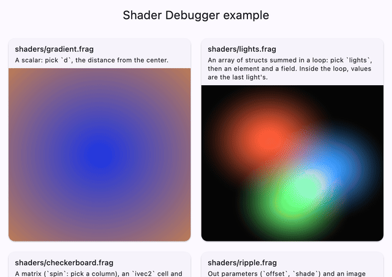
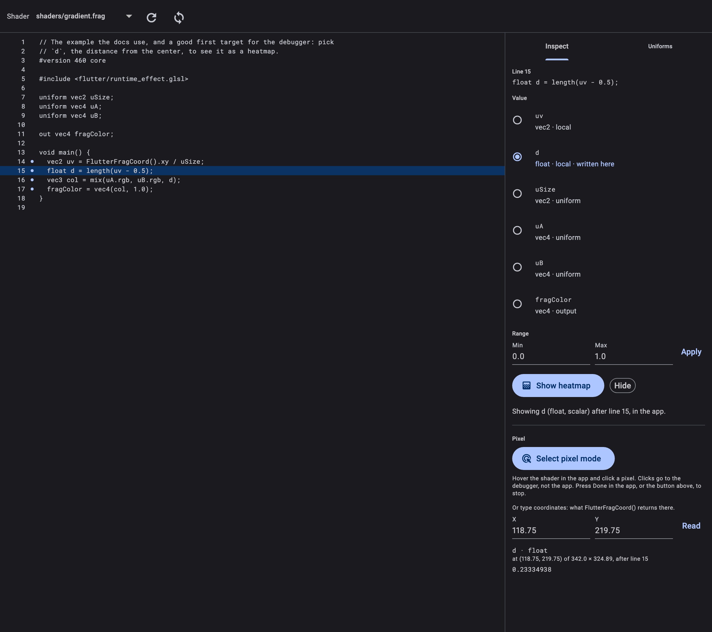
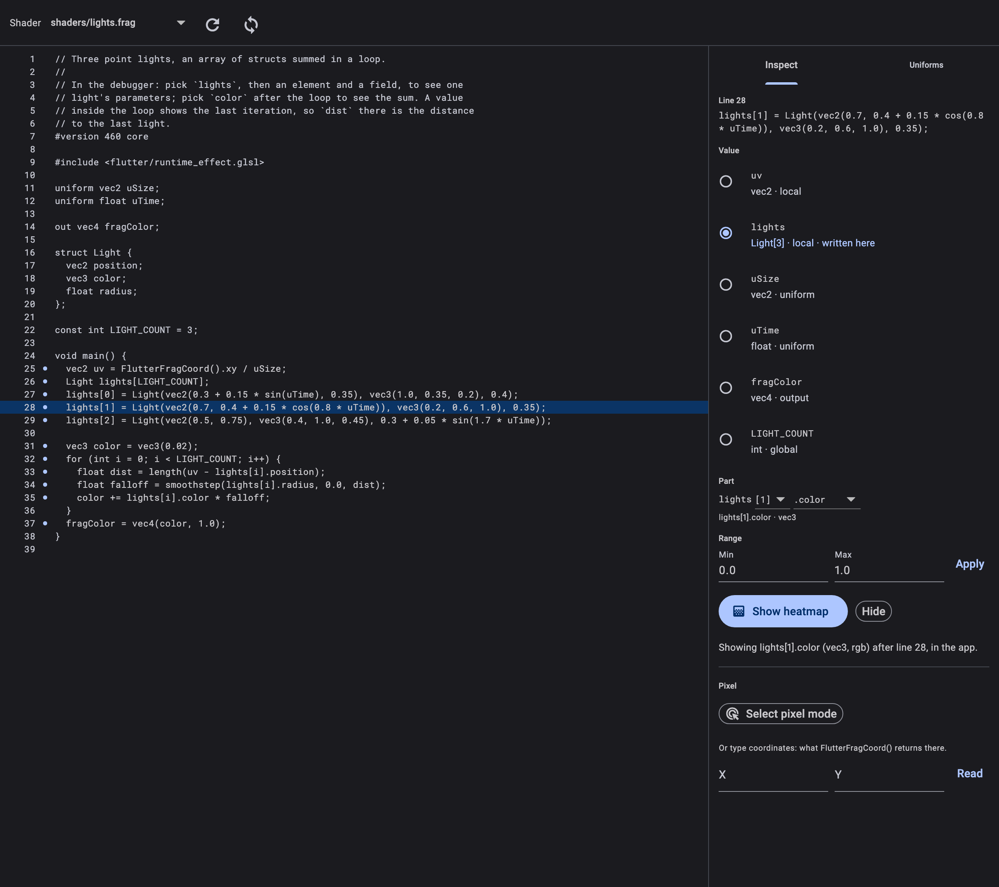
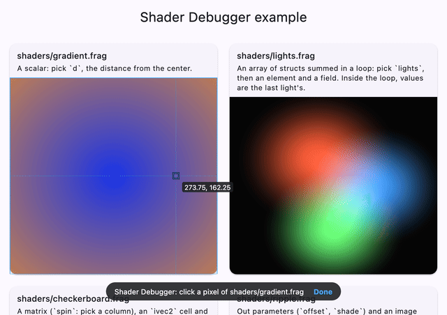
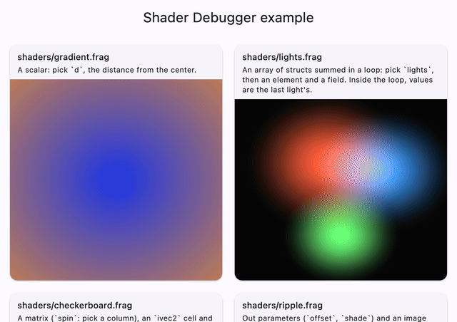
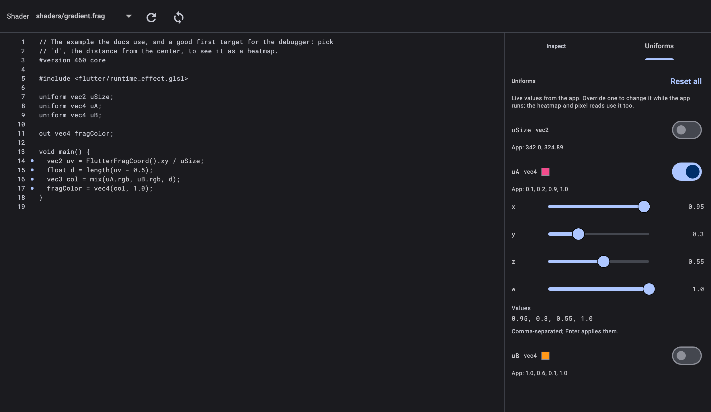

<h1 align="center">Shader Debugger</h1>

<p align="center">
  <strong>Debug Flutter fragment shaders where they run.</strong><br>
  Pick any variable in a <code>.frag</code> file and see it as a live heatmap in
  your app, read its exact value at a pixel, and tweak uniforms while the app
  runs, from a DevTools tab.
</p>

<p align="center">
  <a href="https://pub.dev/packages/shader_debugger"></a>
  <a href="https://github.com/mohamedalsamrai/shader_debugger/actions/workflows/ci.yml"></a>
  <a href="https://github.com/mohamedalsamrai/shader_debugger/blob/main/LICENSE"></a>
  
</p>

<p align="center">
  
</p>

## Features

- **Heatmaps of any value.** Click a line, pick a variable, and every place
  the app draws that shader shows it instead: scalars through a colormap,
  vectors as RG or RGB. Matrices, arrays and structs too: pick a column, an
  element or a field.
- **Exact values at a pixel.** *Select pixel mode* works like the widget
  inspector's: hover the shader in your app, click a pixel, and read the
  value there as 32-bit floats.
- **Live uniform overrides.** Every float uniform gets sliders. The app draws
  with your values, and so do the heatmap and pixel reads.
- **Your shaders stay untouched.** The debugger instruments a copy (a probe),
  swaps it in with hot reload, and keeps your uniforms flowing into it.
- **Debug only.** In profile and release builds, `DebugShader` records
  nothing and draws your shader as is.

## Getting started

### 1. Add the package

```sh
flutter pub add shader_debugger
```

### 2. Register a probe shader

The debugger hot reloads its probe into one shader asset, which your app
registers once. Create `shaders/_debug/probe.frag`:

```glsl
// Placeholder probe for the Shader Debugger. The DevTools extension
// overwrites it while you debug; commit only this placeholder.
#version 460 core

#include <flutter/runtime_effect.glsl>

out vec4 fragColor;

void main() {
  fragColor = vec4(0.0);
}
```

and list it next to your shaders in `pubspec.yaml`:

```yaml
flutter:
  shaders:
    - shaders/my_effect.frag
    - shaders/_debug/probe.frag
```

### 3. Draw your shaders through `DebugShader`

`DebugShader` wraps a `FragmentShader`. Set uniforms by name, and read
`shader` in every paint, after setting them:

```dart
// Load once, for example in main() or initState().
final shader = await DebugShader.fromAsset('shaders/my_effect.frag');

class MyEffectPainter extends CustomPainter {
  MyEffectPainter(this.shader, this.time)
    : _resolution = shader.getUniformVec2('uSize'),
      _time = shader.getUniformFloat('uTime'),
      super(repaint: time);

  final DebugShader shader;
  final ValueListenable<double> time;
  final DebugUniformVec2 _resolution;
  final DebugUniformFloat _time;

  @override
  void paint(Canvas canvas, Size size) {
    _resolution.set(size.width, size.height);
    _time.set(time.value);
    // Read shader.shader after setting the uniforms.
    canvas.drawRect(Offset.zero & size, Paint()..shader = shader.shader);
  }

  @override
  bool shouldRepaint(MyEffectPainter oldDelegate) =>
      oldDelegate.shader != shader;
}
```

`getUniformFloat`, `getUniformVec2`, `getUniformVec3`, `getUniformVec4` and
`getImageSampler` mirror `FragmentShader`'s name-based API.

### 4. Open the Shader Debugger tab

Run the app in debug mode from VS Code or Android Studio, open DevTools
(in VS Code: **Dart: Open DevTools in Browser**) and select the
**shader_debugger** tab. The first time, DevTools asks you to enable the
extension.

> Launch the app from your IDE: the extension writes the probe through the
> Dart Tooling Daemon, which only allows files inside the IDE's workspace.
> Without it, the page offers the probe to paste by hand.

## Usage

### Heatmaps

Pick a shader, click a marked line, choose a value, and press **Show
heatmap**. Lines that write a value select it for you. Set the range to spread
the colormap over the values you care about; it changes without a reload.
Picking another line or value while a heatmap is shown updates it.

<p align="center">
  
</p>

### Matrices, arrays and structs

For a composite value, the **Part** row picks a column, an element or a field,
down to something the probe can draw. A line that writes part of a value
starts there: `lights[1] = Light(...)` selects `lights[1]`.

<p align="center">
  
</p>

### Pixel inspector

Turn on **Select pixel mode**. An overlay covers the app and takes its clicks,
like the inspector's Select Widget Mode: hovering a shader outlines it and
frames the device pixel under the pointer, with its coordinates. Each click
reads the selected value there, shown with nine significant digits. Press
**Done** in the app, or the button in DevTools, to stop. You can also type
coordinates: they are what `FlutterFragCoord()` returns at that pixel.

<p align="center">
  
</p>

### Uniforms

The **Uniforms** tab lists the shader's uniforms with the app's live values.
Turn on **Override** to drive one with sliders, or type exact values;
**Reset all** gives the app its values back.

<p align="center">
  
</p>

<p align="center">
  
</p>

## Platform support

| Platform | Status |
|---|---|
| macOS (Impeller) | Verified end to end, including exact float reads |
| iOS, Android | Expected to work; not verified yet |
| Windows, Linux | Expected to work; pixel reads may be rounded to 8 bits, and the page says so when they are |
| Web | Not supported |

Requires Flutter 3.47 or later. Reports from other platforms are welcome.

## Limitations

- A value inside a loop, or in a function called more than once, shows its
  last write.
- When reading a pixel, every invocation computes the same coordinate, so
  `dFdx`, `dFdy` and `fwidth` are 0.
- A click is mapped through the render box that painted the shader. A painter
  that transforms the canvas before drawing is not accounted for; type the
  coordinates instead.
- `ImageFilter.shader` and `BackdropFilter` shaders are not supported.
- The analyzer follows Flutter's GLSL subset. A line it does not understand
  cannot be picked; the rest of the file still can.

## How it works

The DevTools extension reads your `.frag` file, finds every variable written
and in scope at each line, and generates a probe: a copy of your shader that
also writes the picked value out. It writes the probe into
`shaders/_debug/probe.frag` and hot reloads. In the app, `DebugShader` swaps
the probe in and copies your uniforms onto it on every paint. Pixel reads
draw the probe into a single 32-bit float pixel. The
[architecture notes](https://github.com/mohamedalsamrai/shader_debugger/blob/main/docs/architecture.md)
cover the details.

## Additional information

- **Example:** the [example app](https://github.com/mohamedalsamrai/shader_debugger/tree/main/packages/shader_debugger/example)
  is a gallery of shaders, each with something to try in the debugger.
- **Issues and ideas:** [GitHub issues](https://github.com/mohamedalsamrai/shader_debugger/issues).
- **Contributing:** see the [repository](https://github.com/mohamedalsamrai/shader_debugger)
  for how to build, test and record this README's media.
- **License:** MIT.
