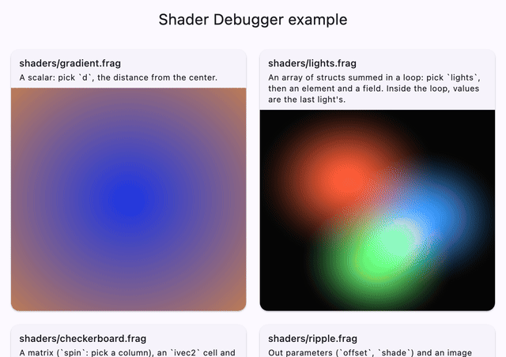

# shader_debugger_core

[](https://pub.dev/packages/shader_debugger_core)
[](https://github.com/mohamedalsamrai/shader_debugger/actions/workflows/ci.yml)
[](https://github.com/mohamedalsamrai/shader_debugger/blob/main/LICENSE)

The pure-Dart engine of the
[Flutter Shader Debugger](https://pub.dev/packages/shader_debugger): a GLSL
analyzer for Flutter fragment shaders, and the instrumenter that turns "show
me this variable at this line" into a probe shader.

It has no `dart:io` or Flutter dependency, so it runs in the DevTools
extension (Flutter web), in command-line tools and on the server.

<p align="center">
  
</p>

Most apps want [`shader_debugger`](https://pub.dev/packages/shader_debugger)
instead, which uses this package. Use this one to build your own shader
tooling.

## Usage

```dart
import 'package:shader_debugger_core/shader_debugger_core.dart';

void main() {
  const source = '''
#version 460 core
#include <flutter/runtime_effect.glsl>

uniform vec2 uSize;
out vec4 fragColor;

void main() {
  vec2 uv = FlutterFragCoord().xy / uSize;
  float d = length(uv - 0.5);
  fragColor = vec4(vec3(d), 1.0);
}
''';

  // What each statement writes, and what is in scope there.
  final analysis = analyzeShader(source);
  for (final statement in analysis.statements) {
    print('${statement.line + 1}: ${statement.span.text}  '
        'writes ${statement.writes.map((v) => v.name)}');
  }

  // A probe that captures d after the line that computes it (lines are
  // 0-based).
  final statement = analysis.statementsOnLine(8).single;
  final probe = instrument(
    analysis,
    CaptureRequest(statement: statement, variable: statement.defaultPick!),
    stamp: 1,
  );
  print(probe.source); // ... float d = length(uv - 0.5); _dbg_value = vec4(d, 0.0, 0.0, 1.0); ...
}
```

## What is inside

| API | What it does |
|---|---|
| `analyzeShader()` | Preprocesses (conditionals, macros, includes), parses and resolves a shader. Never throws: problems become diagnostics, and a statement it does not understand is not pickable. |
| `ShaderAnalysis`, `StatementInfo` | Per statement: what it writes (and which part of it, such as `lights[1].color`), what is in scope, and what to pick first. |
| `SymbolTable`, `Scope`, `GlslSymbol` | Scopes and declarations, with GLSL's visibility rules. |
| `GlslType` | The types Flutter shaders use, how a probe shows each, and the columns, elements and fields a picker can select. |
| `instrument()`, `CaptureRequest`, `Probe` | A probe: an edited copy of the shader that also writes the picked value out, for heatmaps and exact pixel reads. |
| `package:shader_debugger_core/protocol.dart` | The names shared by the runtime and the DevTools extension. |

Probes are checked by compiling them with `impellerc` at every statement of a
corpus of real shaders, the Flutter SDK's own among them. The
[architecture notes](https://github.com/mohamedalsamrai/shader_debugger/blob/main/docs/architecture.md)
cover the analyzer and the probe format.

## License

MIT.
